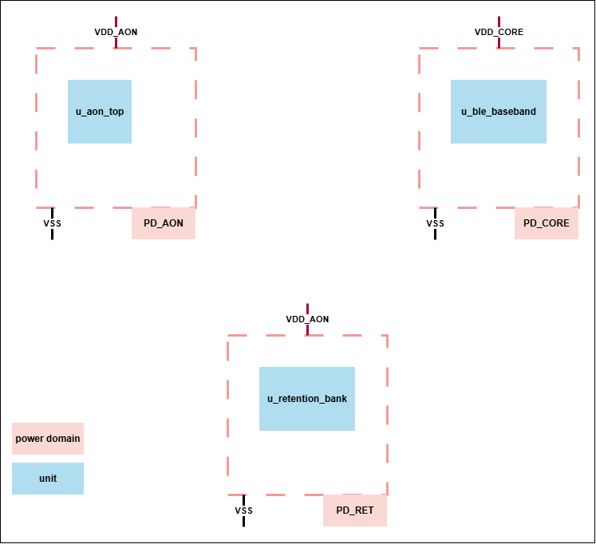

# BLE ULP Link-Layer — Power Architecture

## 1. Block Diagram
A simple diagram showing:
 u_aon_top (timer, wake-up) → PD_AON
 u_ble_baseband (CRC, whitening, FSM) → PD_CORE
 u_retention_bank (connection state) → PD_RET

 

## 2. Power Domains
| Domain | RTL Scope | Supply | Sleep State |
|---|---|---|---|
| PD_AON | u_aon_top, u_pad_ring | VDD_AON | ON |
| PD_CORE | u_ble_baseband | VDD_CORE (switched) | OFF |
| PD_RET | u_retention_bank | VDD_AON | ON (retained) |

## 3. Power State Table
| State | PD_AON | PD_CORE | PD_RET | Description |
|---|---|---|---|---|
| ACTIVE | ON | ON | ON | Packet TX/RX |
| SLEEP | ON | OFF | ON | Between connection events |
| WAKEUP | ON | ON | ON | Transition state |

## 4. Domain Crossings
- **PD_CORE → PD_AON**: Isolation cell, clamp to 0 when PD_CORE OFF.
- **PD_RET ↔ PD_CORE**: Retention flops with save/restore signals.
- **Voltage**: Assume single voltage for Day 1; level shifters to be added if multi-voltage is enabled later.

## 5. Rationale
The BLE baseband module needs to be gated. Otherwise it is always on and consumes lots of power, which is not a good situation for an ultra low power chip. In the sleep mode, it is off and saves power.

## 6. Power Switch Strategy
- **Switch**: `core_pwr_sw`, header switch for `PD_CORE`.
- **Control**: `core_pwr_en`, generated by `u_aon_ctrl` in `PD_AON`.
- **ON state**: `core_pwr_en = 1` → `VDD_CORE` powered → baseband active.
- **OFF state**: `core_pwr_en = 0` → `VDD_CORE` gated → isolation clamps outputs to 0.
- **PST mapping**: ACTIVE/WAKEUP → `core_pwr_en=1`; SLEEP → `core_pwr_en=0`.